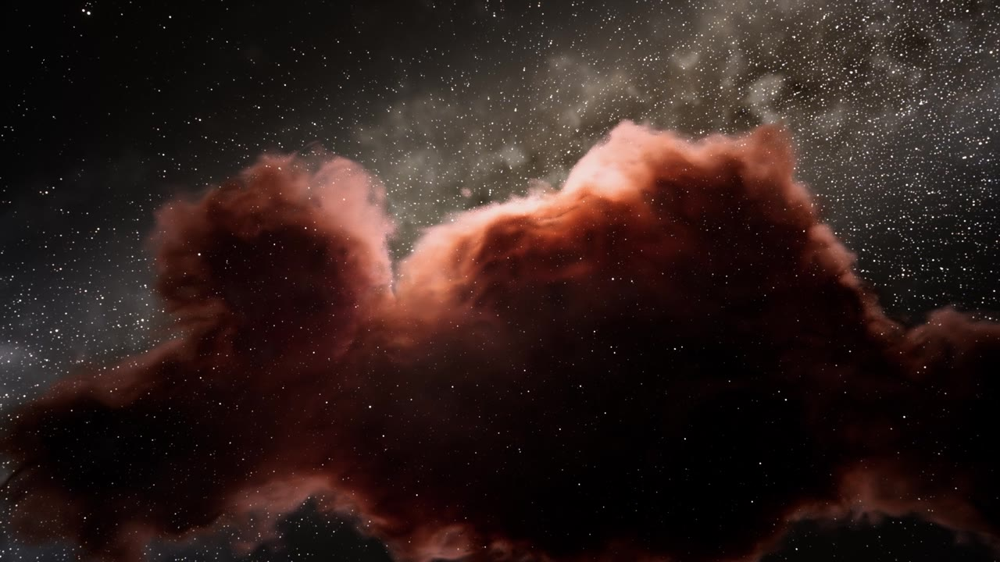
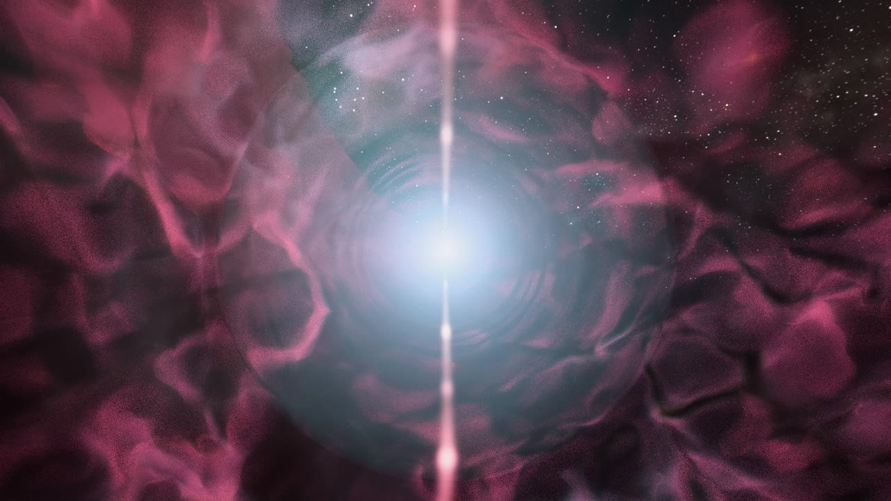
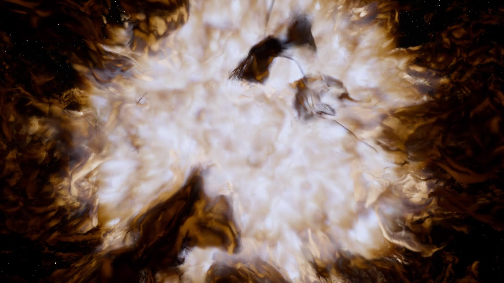
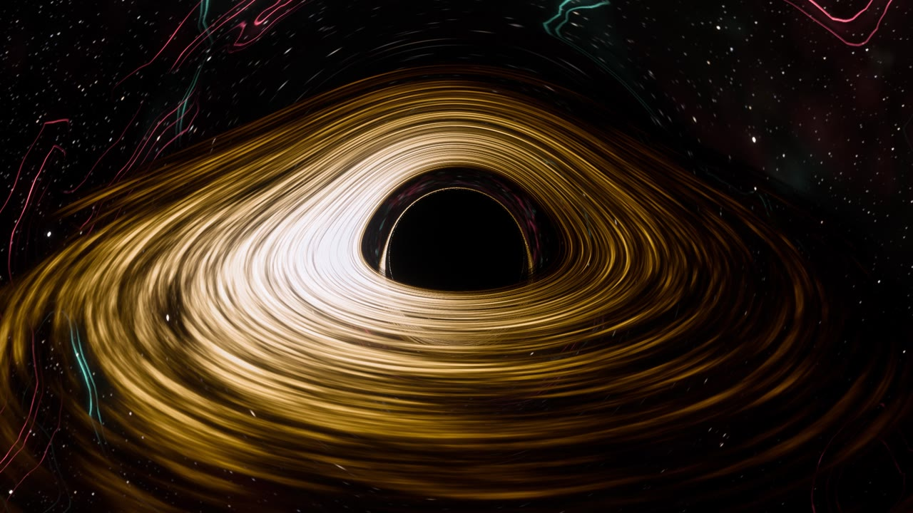
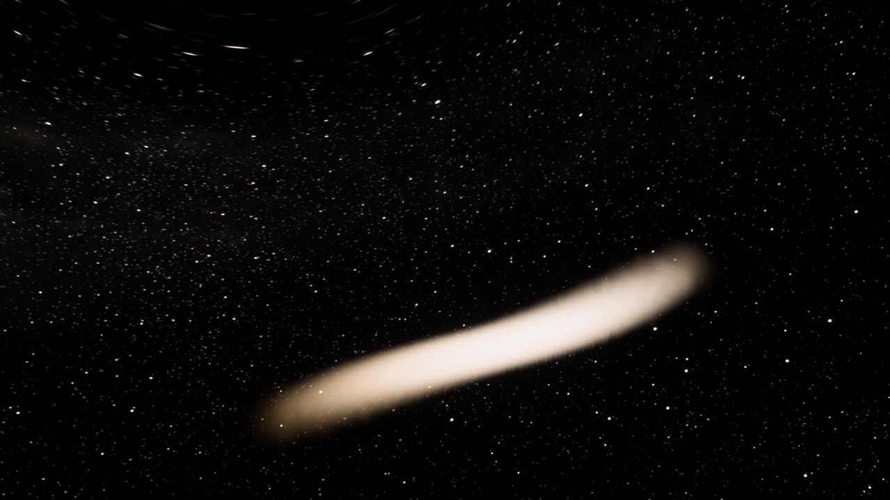
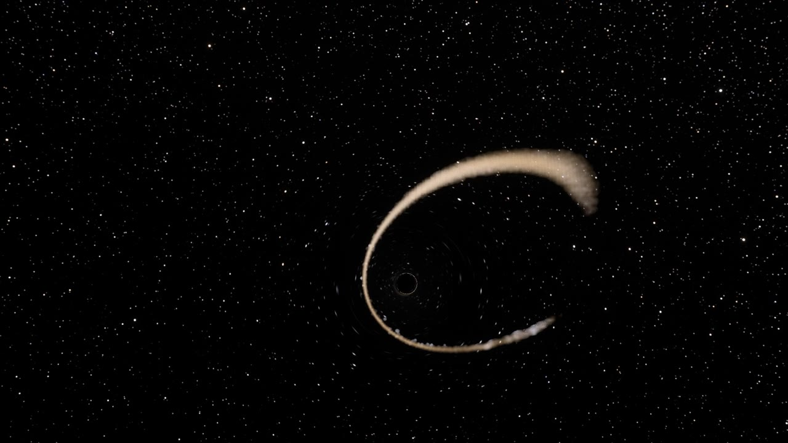
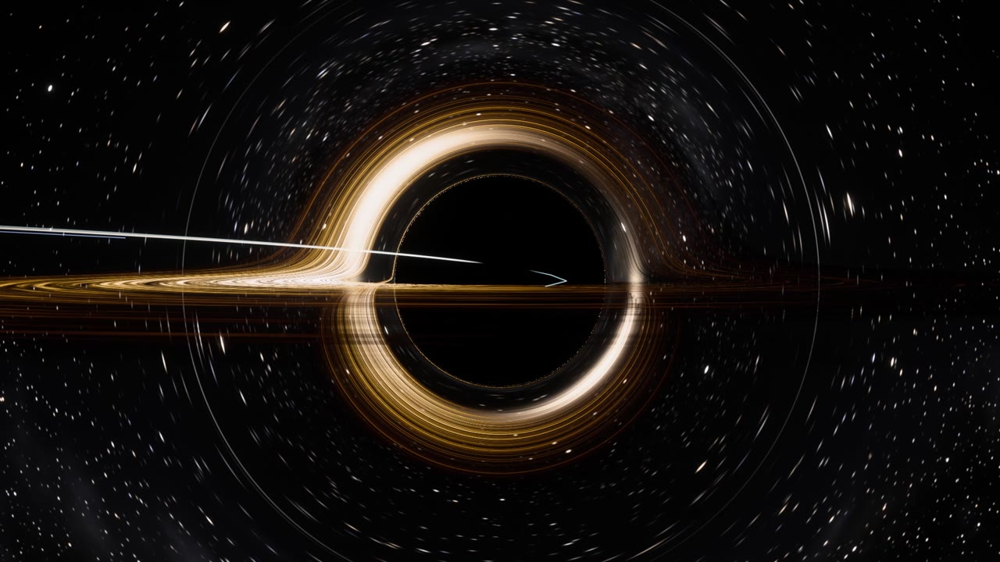
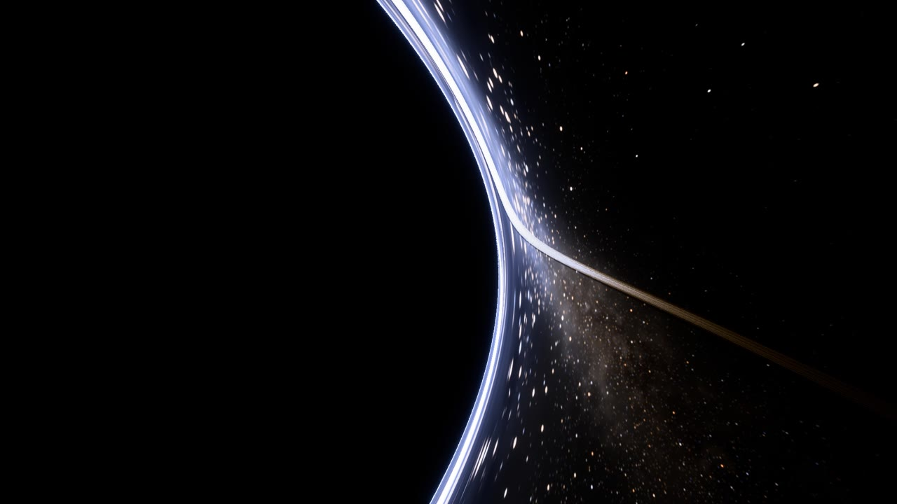

# EVENT HORIZON

**English** · [繁體中文](README.zh-TW.md)

A 13-minute film about black holes in which every pixel is computed. There are no 3D models, meshes, textures, image
files, fonts or text. Light is traced along curved spacetime per pixel. The gas that falls into the hole comes from
hydrodynamics simulations. Our solar system's fall comes from an N-body integration. The film is set to Hans Zimmer's
*Interstellar Main Theme* (extended edit, 12:55), and its six acts follow the six loops of the music.

| | |
|---|---|
|  |  |
|  |  |
|  |  |
|  |  |

## The film

| act | time | what happens |
|---|---|---|
| I · The Endless | 0:00–2:23 | First star, the Milky Way, a dive into thousands of galaxies; a dark molecular cloud collapses into a spinning disk and a massive star ignites |
| II · The Giant | 2:23–4:02 | The blue supergiant swells into a red supergiant, its iron core grows and collapses: supernova, light echoes, a remnant |
| III · Birth | 4:02–6:25 | A black hole inside the remnant: lensed filaments, an Einstein ring; ejecta fall back, collide and settle into a ring; the disk spreads inward and ignites |
| IV · Devour | 6:25–8:47 | A sun-like star is torn apart; its debris swings round the hole again and again; the hole grows into a quasar at a galaxy's heart |
| V · Us | 8:47–10:26 | Our solar system falls into a 1.5-billion-solar-mass hole; the Sun is lensed into a ring and swallowed |
| VI · Horizon | 10:26–12:55 | First person: we fall through the horizon; the universe shrinks to a blueshifted ring, then a line, then nothing |

## What is computed

| | method | where |
|---|---|---|
| light | Schwarzschild null geodesics per pixel, RK4 on `x'' = -3/2 h² x / r⁵` (units r_s = c = 1); the light is never drawn, only imaged | `app/shaders/bh.frag` |
| accretion disk | thin disk, `T ∝ r^-3/4 (1 - √(r_in/r))^1/4`, blackbody colour at the Doppler + gravitationally shifted temperature, relativistic beaming | `bh.frag` |
| observers | static observer (aberration, blueshift) or free-falling observer in the rain frame, valid through the horizon; inside, the sky is seen only outside a black cone of half-angle `arccos √r` ahead | `bh.frag` |
| sky | procedural stars (four magnitude layers), Milky Way with dust lanes, deep-field galaxies, all filtered by the ray footprint so that lensing magnification never aliases | `app/shaders/sky.glsl` |
| fallback disk (III) | SPH with 24k particles: ideal gas, artificial viscosity, radiative cooling of shock heat, Paczyński–Wiita hole, accretion inside 3 r_s | `tools/sph/fallback.py` |
| tidal disruption (IV) | SPH with 32k particles: an n = 1.5 polytrope star (M = 10⁻⁶ M_bh, R = 0.236 r_s) on an eccentric orbit with penetration β = 2, GPU direct-sum self-gravity, cooling | `tools/sph/tde.py` |
| solar system (V) | N-body: the Sun and the eight planets on their real orbits, DOP853, Paczyński–Wiita hole of 1.5×10⁹ M☉ (r_s = Neptune's orbit) | `tools/sph/solar.py` |
| gas rendering | each frame the particles are splatted (cubic kernel) into two nested 160³ volumes of density, temperature and velocity; emission and absorption are integrated along the bent rays, with Doppler and gravitational shifts | `app/src/sim.js`, `bh.frag` |
| nebula, star, supernova, galaxy (I, II, IV) | procedural volumes: emission lines (H-α, [O III], [S II]), blackbody photospheres, a Lane–Emden interior, logarithmic spiral arms. These are physically motivated, not hydrodynamics | `app/shaders/{nebula,star,nova,galaxy}*` |

The light is exact general relativity for a non-rotating hole. The gas dynamics are pseudo-Newtonian (Paczyński–Wiita),
which reproduces the innermost stable orbit and the apsidal precession that makes the debris cross itself.

## Running it

Requirements: Node 22+, Google Chrome (driven headless through ANGLE/Metal WebGL2), ffmpeg, Python 3.12
(e.g. with [uv](https://docs.astral.sh/uv/)). The film was rendered on an Apple M5.

```bash
npm install
uv venv tools/.venv --python 3.12
uv pip install --python tools/.venv/bin/python -r tools/requirements.txt
```

**Music.** The soundtrack is not included. Put your own copy of the track at `audio/src/theme.mp3`, then:

```bash
ffmpeg -i audio/src/theme.mp3 -ar 44100 -ac 2 audio/theme.wav
```

The beat grid and loudness envelopes the film is cut to are already in `app/data/` (`audio.json`, `grid.json`).
Regenerate them with `tools/analyze.py` and `tools/grid.py` only if you change the music.

**Simulations.** Their output is not in the repository (about 3.5 GB). Regenerate it with:

```bash
tools/.venv/bin/python tools/sph/solar.py                                    # ~1 min
FB_N=24000 FB_TEND=4200 tools/.venv/bin/python tools/sph/fallback.py                     # ~30 min
TDE_N=32000 tools/.venv/bin/python tools/sph/tde.py relax                    # ~25 min
TDE_COOL=1.0 TDE_TEND=11500 TDE_DTSNAP=4 tools/.venv/bin/python tools/sph/tde.py run   # ~2.5 h
```

**Rendering.**

```bash
node tools/render.mjs sheet --pershot --scale 0.3 --spp 2 --tag check     # contact sheet of every shot
node tools/render.mjs video --from 360 --to 385 --audio audio/theme.wav --out out/clip.mp4
node tools/render.mjs produce --chunk 20 --final --out out/EventHorizon.mp4  # the whole film, resumable
```

`produce` renders 20-second chunks into `out/chunks/` and skips the ones that already exist. To re-render part of
the film, delete those chunks and run it again; `--final` joins the chunks and adds the music. The full film is about
7 hours at 1080p30 with 4–12 sub-frames per frame. The sub-frames add motion blur and anti-aliasing, and the camera's
angular speed decides how many each frame gets.

QA tools: `node tools/cutcheck.mjs` (flags jump cuts), `node tools/motion.mjs` (fast camera moves),
`tools/.venv/bin/python tools/qa_scan.py out/chunks/*.mp4` (broken, black or frozen frames).

## Layout

```
app/
  src/         engine (HDR sub-frame accumulation, bloom, ACES / hue-preserving tone mapping, dissolves),
               timeline, shots/act1–6.js (the film), scenes/ (per-scene staging), sim.js (simulation playback)
  shaders/     bh.frag (geodesics), sky.glsl, nebula*, star*, nova.frag, remnant_lib.glsl, galaxy*, post_*
  data/        music analysis; sim/ holds generated simulation snapshots
tools/         render.mjs (offline driver), sph/ (SPH and N-body codes), analysis and QA scripts
docs/          STORYBOARD.md (shot by shot, on the bar grid), BRIEF.md (engine API), scenes/ (scene notes)
```

## License

The source code is released under the [MIT License](LICENSE). The film, its stills (`docs/images/`) and the author's
renders are © 2026 Tunai, all rights reserved; see [LICENSE-MEDIA.md](LICENSE-MEDIA.md). The music, *Interstellar Main
Theme* by Hans Zimmer, is not part of this repository.
